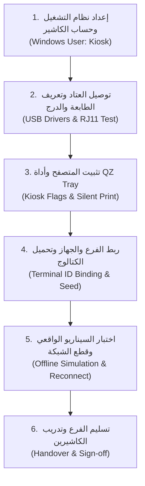

# 🛠️ دليل التجهيز الميداني وتثبيت الأدوات لنقاط البيع (POS) في الفروع
## Hafez ERP · خطة تهيئة وتدشين الأجهزة عبر شبكة فروع وزير الحلو

> **المؤلف:** المهندس حافظ رحيم & فريق التطوير التقني  
> **التاريخ:** نوفمبر 2026  
> **النطاق:** 10 فروع رئيسية + 5 فروع توسع + المصنع المركزي والمطبخ السحابي

---

## 📋 فهرس الدليل

1. [نظرة عامة على بيئة العمل في الفروع](#1)
2. [قائمة العتاد والأجهزة المطلوبة لكل فرع (Hardware Checklist)](#2)
3. [البرمجيات والأدوات الواجب تثبيتها (Software & Tools Stack)](#3)
4. [تهيئة الطباعة الصامتة وفتح درج النقدية المباشر](#4)
5. [خطوات الإعداد والتهيئة الميدانية خطوة بخطوة (Step-by-Step Playbook)](#5)
6. [تجهيز وربط الفرع بالأرقام التعريفية (Terminal Binding)](#6)
7. [آلية الدعم الفني والمراقبة عن بُعد (Remote Management)](#7)
8. [جدول النشر والتدشين على الفروع (Rollout Timeline)](#8)

---

## 1. نظرة عامة على بيئة العمل في الفروع {#1}

تتميز فروع محلات الحلويات بضغط تشغيلي عالي وطوابير عملاء سريعة خاصة في أوقات الذروة والمواسم (شهر رمضان، الأعياد، عطلات نهاية الأسبوع). لذلك يجب أن تتسم أجهزة الكاشير بـ:
- **الاستقرار التام:** عدم توقف الجهاز حتى لو انقطعت الكهرباء أو انقطع كابل الإنترنت.
- **السرعة اللحظية:** إتمام الفاتورة وطباعتها وفتح درج النقدية في أقل من **1.5 ثانية**.
- **البساطة:** واجهة تعمل باللمس فقط، بدون الحاجة لتدخل الكاشير في إعدادات الويندوز أو المتصفح.

---

## 2. قائمة العتاد والأجهزة المطلوبة لكل فرع (Hardware Checklist) {#2}

لكل نقطة بيع (POS Counter) في أي فرع، يجب توفير وتجهيز العتاد التالي:

```
┌────────────────────────────────────────────────────────────────────────┐
│                      مكونات كاونتر الكاشير في الفرع                    │
├────────────────────────────────────────────────────────────────────────┤
│  [1] شاشة لمس All-in-One POS Terminal (Windows 11 IoT / Core i5)       │
│  [2] طابعة فواتير حرارية 80mm ESC/POS (USB + LAN Ethernet)             │
│  [3] درج نقدية إلكتروني معدني (RJ11 متصل بالطابعة)                     │
│  [4] قارئ باركود ليزري 1D / 2D QR Scanner (USB Plug & Play)           │
│  [5] وحدة تزويد طاقة لا تنقطع UPS (1000VA - تضمن 45 دقيقة تشغيل)      │
│  [6] راوتر اتصال احتياطي Dual-WAN مع شريحة 4G LTE Failover             │
└────────────────────────────────────────────────────────────────────────┘
```

| المكون | المواصفات الفنية المعتمدة | الغرض التشغيلي |
|:-------|:--------------------------|:--------------|
| **جهاز الكاشير الرئيسي** | شاشة 15.6 بوصة Capacitive Touch، معالج Core i3/i5، رام 8GB، SSD 128GB، نظام Windows 10/11 Pro | تشغيل واجهة الـ POS والذاكرة المحلية IndexedDB |
| **طابعة الإيصالات الحرارية** | 80mm Thermal Receipt Printer (سرعة 250mm/s) تدعم أوامر ESC/POS ومنافذ USB + Ethernet | طباعة بونات الاستلام والفواتير الضريبية المبسطة |
| **درج النقدية الإلكتروني** | درج نقدية حديدي 5 خانات للورق + 8 خانات للعملات المعدنية، كابل RJ11 | يفتح آلياً مع طباعة إيصال الدفع النقدي |
| **ماسح الباركود** | قارئ باركود سلكي USB يدعم باركود الأوزان والأصناف ورموز QR | قراءة بونات الميزان وأصناف العلب المغلفة |
| **وحدة UPS للطاقة** | 800VA – 1200VA Line-Interactive | حماية الجهاز من انقطاع الكهرباء اللحظي وتلف قاعدة البيانات |
| **إنترنت احتياطي 4G** | راوتر محلي به خاصية Failover مع شريحة بيانات 4G (فودافون/أورنج/وي) | تحويل الاتصال تلقائياً فور سقوط الخط الأرضي DSL/Fiber |

---

## 3. البرمجيات والأدوات الواجب تثبيتها في كل جهاز {#3}

لتوفير أعلى مستويات الموثوقية والسرعة، يتم تثبيت حزمة البرمجيات التالية على نظام تشغيل كل كاشير:

### 1. متصفح Google Chrome (أو Microsoft Edge) مخصص للـ POS
- **التهيئة:** يعمل في وضع **Kiosk Mode** بشاشة كاملة بدون أشرطة عنوان أو أزرار إغلاق.
- **تفعيل ميزة التخزين الدائم (Persistent Storage):** لضمان عدم قيام المتصفح بحذف قاعدة بيانات `IndexedDB` عند امتلاء القرص.

### 2. تثبيت تطبيق الـ PWA (Progressive Web App)
- تثبيت تطبيق الـ ERP POS كبرنامج نظامي على سطح المكتب برابط مباشر `https://erp.wazeer-elhelw.com/pos`.
- تفعيل الـ **Service Worker** تلقائياً لتخزين الكتالوج وصفحات البيع والـ assets محلياً.

### 3. أداة الطباعة الصامتة المباشرة (Silent Direct Printing Engine)
> **المشكلة:** متصفحات الويب تُظهر نافذة حوار الطباعة (Print Dialog) عند كل طلب، وهو ما يعطل الكاشير.  
> **الحل المعتمد:** استخدام أحد الخيارين:
> - **الخيار الأول (الموصى به - صفر تثبيت):** تفعيل علم المتصفح `--kiosk-printing` الذي يطبع مباشرة على الطابعة الافتراضية بدون أي نافذة تأكيد.
> - **الخيار الثاني (للطباعة الحرارية المتقدمة وفتح الدرج):** تثبيت أداة **QZ Tray** كخدمة خلفية (Background Service) لإرسال أوامر ESC/POS الخام عبر منفذ USB مباشرة وتشغيل قاطع الورق وفتح الدرج كهربائياً.

### 4. أداة الدعم الفني والتحكم عن بُعد (Remote Management)
- تثبيت برنامج **RustDesk** (مفتوح المصدر وخاص بخوادم الشركة) أو **AnyDesk** كخدمة ذاتية مع كلمة مرور وصول غير مراقب (Unattended Access)، لتمكين فريق الدعم المركزي من حل أي مشكلة خلال ثوانٍ.

### 5. أداة مراقبة المزامنة وسجل البيانات (Local POS Watchdog)
- سكربت خفيف مبرمج بـ PowerShell أو Node.js يعمل في الخلفية كـ Windows Task Scheduler:
  - يفحص حالة الإنترنت كل دقيقة.
  - يتحقق من سلامة خدمة الطباعة.
  - ينبه المشرف عند تراكم أكثر من 50 طلباً محلياً غير متزامن لأكثر من ساعة.

---

## 4. تهيئة الطباعة الصامتة وفتح درج النقدية المباشر {#4}

### أ) إعداد الكاشير للطباعة التلقائية (Chrome Kiosk Printing)
يتم تعديل اختصار تشغيل المتصفح على سطح المكتب ليحتوي على المعاملات التالية:

```bat
"C:\Program Files\Google\Chrome\Application\chrome.exe" ^
  --app=https://erp.wazeer-elhelw.com/pos ^
  --kiosk ^
  --kiosk-printing ^
  --disable-pinch ^
  --overscroll-history-navigation=0 ^
  --user-data-dir="C:\POS_UserData"
```

* **`--kiosk`**: تشغيل التطبيق بملء الشاشة وإخفاء أزرار الإغلاق وتصغير النوافذ.
* **`--kiosk-printing`**: يطبع الإيصال فوراً على الطابعة الحرارية الافتراضية بدون إظهار نافذة المعاينة.
* **`--user-data-dir`**: عزل بيانات الكاشير في مجلد مخصص منعاً لمسحه بالخطأ مع تاريخ التصفح.

### ب) كود فتح درج النقدية كهربائياً عبر كابل الطابعة (RJ11 ESC/POS)
عند إتمام الدفع النقدي، يُرسل النظام أمر ESC/POS الخام لفتح الدرج مع الإيصال:

```javascript
// ESC/POS Command: Open Cash Drawer Pin 2 (200ms pulse)
const OPEN_DRAWER_HEX = "\x1B\x70\x00\x19\xFA";

export function triggerCashDrawer() {
  if (window.qz) {
    // عبر QZ Tray
    const config = window.qz.configs.create("POS-80-Printer");
    const data = [OPEN_DRAWER_HEX];
    return window.qz.print(config, data);
  } else {
    // عبر نافذة الطباعة الافتراضية
    window.print();
  }
}
```

---

## 5. خطوات الإعداد والتهيئة الميدانية خطوة بخطوة {#5}

يقوم مهندس الدعم الفني بتنفيذ هذه الخطوات بالترتيب عند تجهيز أي جهاز فرع:



### الخطوة 1: ضبط نظام التشغيل وحماية البيئة
1. إنشاء مستخدم ويندوز محلي باسم `Cashier` بدون صلاحيات Administrator.
2. تفعيل تسجيل الدخول التلقائي (Auto-login) عند تشغيل الجهاز بدون طلب كلمة مرور للويندوز.
3. تعطيل شاشات التوقف وتحديثات الويندوز التلقائية أثناء ساعات العمل (تحديد الساعات النشطة 08:00 ص – 03:00 ص).
4. ضبط دقة الشاشة ومعدل التكبير على 100% لتوافق مثالي مع شاشة اللمس.

### الخطوة 2: تثبيت الطابعة والماسح ودرج النقدية
1. توصيل طابعة الفواتير الحرارية بمنفذ USB وتثبيت تعريفها (Driver: POS-80 / Xprinter / Bixolon / Epson).
2. تسمية الطابعة في لوحة التحكم باسم موحد: `POS-Receipt-Printer` وجعلها الطابعة الافتراضية (Default Printer).
3. ضبط حجم الورق في خصائص الطباعة على `80mm x 297mm` مع اختيار `Cut Paper` بعد كل بون.
4. تفعيل خيار `Open Cash Drawer` من تبويب Device Settings في تعريف الطابعة ليفتح مع نهاية الطباعة.
5. اختبار ماسح الباركود على صنف علبة كعك أو فتة وتأكيد قراءة الكود متبوعاً بمفتاح `Enter`.

### الخطوة 3: تثبيت الـ PWA وتفعيل التخزين الدائم
1. فتح متصفح Chrome والدخول على رابط النظام: `https://erp.wazeer-elhelw.com/pos`.
2. النقر على أيقونة التثبيت في شريط العنوان (Install POS App) ليظهر التطبيق كنافذة مستقلة على سطح المكتب.
3. في وحدة التحكم (Console) أو من إعدادات النظام، يتم تفعيل التخزين الدائم برمجياً:
   ```javascript
   if (navigator.storage && navigator.storage.persist) {
     const isPersisted = await navigator.storage.persist();
     console.log(`Persistent storage granted: ${isPersisted}`);
   }
   ```
4. إضافة اختصار التشغيل في مجلد بدء التشغيل التلقائي للويندوز (`shell:startup`) لفتح الـ POS فور إقلاع الجهاز.

### الخطوة 4: تحميل الكتالوج المسبق (Initial Offline Snapshot)
1. تسجيل دخول الكاشير المشرف لمرة واحدة بالإنترنت.
2. الضغط على زر **"تحديث الكتالوج الكامل"** ليقوم النظام بتخزين:
   - كافة الأصناف والأسعار (شرقي، غربي، أرز بلبن، قشطوطة، آيس كريم، تورت).
   - قوائم العملاء الأكثر تكراراً.
   - قائمة الكاشيرين المصرح لهم في هذا الفرع مع تشفير الـ PINs.
3. التأكد من ظهور إشعار: `تم تحميل 100% من الكتالوج محلياً (جاهز للعمل بلا إنترنت)`.

### الخطوة 5: اختبار فصل كابل الشبكة (Live Offline Drill)
1. نزع كابل الإنترنت وفصل الـ Wi-Fi عمداً.
2. ملاحظة تحول شريط الحالة في الشاشة فوراً إلى اللون الأحمر: `🔴 بلا إنترنت (الوضع المحلي نشط)`.
3. إتمام 3 فواتير تجريبية متنوعة (تيك أواي وصالة) مع طباعة البونات وفتح الدرج.
4. التأكد من زيادة عداد: `📦 3 طلبات محفوظة في انتظار المزامنة`.
5. إعادة توصيل كابل الإنترنت ومراقبة الشاشة:
   - تحول الشريط للأخضر: `🟢 تم استعادة الاتصال`.
   - انخفاض عداد المعلقات تدريجياً حتى يصل إلى `0`.
   - ظهور توست نجاح: `✅ تمت مزامنة 3 طلبات مع الخادم المركزي بنجاح`.

---

## 6. تجهيز وربط الفرع بالأرقام التعريفية (Terminal Binding) {#6}

كل نقطة بيع يجب أن تحمل معرّفاً فريداً ثابتاً في النظام لمنع تداخل أرقام الفواتير:

```json
{
  "companyId": "wazeer_el_helw",
  "branchId": "korba",
  "branchNameAr": "فرع الكوربة — مصر الجديدة",
  "terminalId": "term-01",
  "receiptPrefix": "INV-KB1-",
  "printerConfig": {
    "type": "esc_pos",
    "interface": "usb",
    "paperWidthMm": 80,
    "autoCut": true,
    "openDrawer": true
  },
  "installedAt": "2026-11-20",
  "deviceMacAddress": "B4:2E:99:A1:7B:12"
}
```

### قائمة الفروع والمعرفات المعتمدة:

| كود الفرع (`branchId`) | اسم الفرع | معرّف الكاشير 1 | معرّف الكاشير 2 | بادئة الفاتورة |
|:-----------------------|:----------|:----------------|:----------------|:---------------|
| `korba` | فرع الكوربة — مصر الجديدة | `term-01` | `term-02` | `INV-KB-` |
| `abbas` | فرع عباس العقاد — مدينة نصر | `term-01` | `term-02` | `INV-AB-` |
| `helmeya` | فرع الحلمية — حلمية الزيتون | `term-01` | — | `INV-HL-` |
| `khosoos` | فرع الخصوص — القليوبية | `term-01` | `term-02` | `INV-KH-` |
| `wost_elbalad` | فرع وسط البلد — طلعت حرب | `term-01` | `term-02` | `INV-WB-` |
| `giza` | فرع الجيزة — ميدان الجيزة | `term-01` | — | `INV-GZ-` |
| `faisal` | فرع فيصل الرئيسي | `term-01` | `term-02` | `INV-FS-` |
| `dar_elsalam` | فرع دار السلام — الكورنيش | `term-01` | — | `INV-DS-` |
| `october_gardens`| فرع حدائق أكتوبر — زويل | `term-01` | — | `INV-OG-` |
| `ahram_gardens` | فرع حدائق الأهرام — البوابة الثانية | `term-01` | — | `INV-AG-` |
| `hosary` | فرع الحصري — 6 أكتوبر | `term-01` | `term-02` | `INV-HS-` |
| `sheikh_zayed` | فرع الشيخ زايد — أمريكانا بلازا | `term-01` | `term-02` | `INV-SZ-` |
| `mansoura` | فرع المنصورة — المشاية | `term-01` | — | `INV-MN-` |
| `banha` | فرع بنها — الإشارة والفلل | `term-01` | — | `INV-BN-` |
| `tenth_ramadan`| فرع العاشر والمصنع المركزي | `term-01` | `term-02` | `INV-TR-` |

---

## 7. آلية الدعم الفني والمراقبة المركزية (Remote Management) {#7}

لضمان راحة البال لإدارة السلسلة والمشرفين، تتضمن الخطة نظام مراقبة استباقي من غرفة التحكم المركزية:

```
┌────────────────────────────────────────────────────────────────┐
│               لوحة التحكم المركزية لحالة الفروع                │
├────────────────────────────────────────────────────────────────┤
│  🏢 الكوربة:      🟢 متصل (Online)    │ المعلقات: 0   │ شغال 100% │
│  🏢 الخصوص:       🟢 متصل (Online)    │ المعلقات: 0   │ شغال 100% │
│  🏢 فيصل:         🟡 اتصال ضعيف       │ المعلقات: 4   │ جارٍ المزامنة │
│  🏢 وسط البلد:    🔴 غير متصل (Offline)│ المعلقات: 18  │ يعمل محلياً │
└────────────────────────────────────────────────────────────────┘
```

1. **إرسال نبض الحياة (Heartbeat Ping):** كل جهاز يرسل إشارة للخادم كل 60 ثانية توضح:
   - حالة الاتصال (Online / Offline).
   - عدد الطلبات المعلقة في IndexedDB محلياً.
   - مساحة القرص المتبقية وحالة ورق الطابعة.
2. **تنبيهات فورية للمشرف (Telegram / WhatsApp Bots):**
   - في حال استمرار فرع في وضع الـ Offline لأكثر من **90 دقيقة**.
   - في حال تراكم أكثر من **50 فاتورة معلقة** دون مزامنة.
3. **التدخل السريع عن بُعد:**
   - بضغطة زر من إدارة النظام المركزية، يستطيع مهندس الدعم فتح جلسة RustDesk مشفرة مع شاشة الكاشير لحل أي عائق فوراً.

---

## 8. جدول النشر والتدشين على الفروع (Rollout Timeline) {#8}

يتم تنفيذ خطة التجهيز الميداني على **4 موجات زمنية** متسلسلة لضمان الجودة وعدم تعطيل العمل:

```
╔═══════════════════════════════════════════════════════════════════════╗
║                      مراحل النشر الميداني للفروع                     ║
╠═══════════════════════════════════════════════════════════════════════╣
║  الموجة 1 (أسبوع 1): الفرع النموذجي التجريبي (Pilot - الكوربة)        ║
║  الموجة 2 (أسبوع 2): فروع شرق القاهرة والقليوبية (عباس، الحلمية، الخصوص)║
║  الموجة 3 (أسبوع 3): فروع الجيزة وغرب القاهرة (وسط البلد، فيصل، زايد) ║
║  الموجة 4 (أسبوع 4): الفروع الإقليمية والمصنع (العاشر، المنصورة، بنها)  ║
╚═══════════════════════════════════════════════════════════════════════╝
```

| المرحلة | الفروع المشمولة | الإجراءات الميدانية | المدة |
|:--------|:----------------|:--------------------|:------|
| **الموجة 1 (Pilot)** | فرع الكوربة (جهازين) | تركيب الأجهزة الجديدة، اختبار الطباعة الصامتة، محاكاة بيع كامل بلا إنترنت، وتدريب طاقم كاشيري الكوربة | 5 أيام عمل |
| **الموجة 2** | عباس العقاد، الحلمية، الخصوص | توريد العتاد، ضبط Kiosk Mode، ربط الطابعات، وتدشين وضع المزامنة التلقائية | 5 أيام عمل |
| **الموجة 3** | وسط البلد، الجيزة، فيصل، دار السلام، حدائق أكتوبر، الشيخ زايد، الحصري | تهيئة 9 نقاط بيع، تدريب المشرفين على قراءة شاشة المزامنة، واختبار الطوارئ | 6 أيام عمل |
| **الموجة 4** | المنصورة، بنها، فرع العاشر ومصنع الإنتاج | تجهيز الكاشيرات، ربط فواتير المصنع والمبيعات، وتفعيل لوحة المراقبة المركزية | 4 أيام عمل |

---

## 📌 قائمة التحقق النهائية قبل تسليم الكاشير (Go-Live Checklist)

* [ ] تم تثبيت ويندوز وتخصيص مستخدم `Cashier` بدون صلاحية مدير.
* [ ] تم جعل طابعة الإيصالات الحرارية هي الافتراضية مع اختبار فتح درج النقدية.
* [ ] تم تثبيت الـ PWA وضبط اختصار Kiosk Mode بشاشة كاملة وطباعة صامتة.
* [ ] تم عمل تفعيل للتخزين الدائم `navigator.storage.persist()`.
* [ ] تم تسجيل الجهاز برقم الـ Terminal والـ Branch وتأكيد مطابقة بادئة الفاتورة.
* [ ] تم فصل الإنترنت واختبار حفظ وطباعة 3 فواتير ومزامنتها بنجاح فور إعادة الشبكة.
* [ ] تم تدريب الكاشير على إدخال رمز الـ PIN وقراءة مؤشر الاتصال الملون (أخضر / أصفر / أحمر).
* [ ] تم تثبيت برنامج الدعم عن بُعد RustDesk وتدوين معرّف الجهاز في سجل الدعم المركزي.

---

**اعتماد خطة التجهيز الميداني:**  
**المهندس حافظ رحيم** — رئيس الفريق التقني لمشروع Hafez ERP لسلسلة حلويات وزير الحلو
