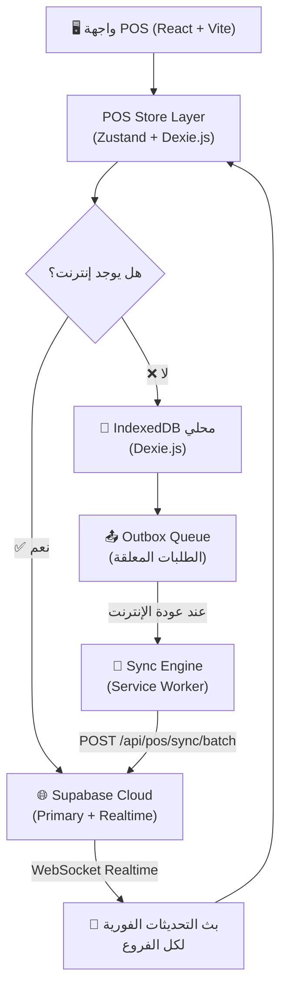

# 🏪 خطة نظام نقطة البيع — العمل بدون إنترنت وبالإنترنت
## Hafez ERP · سلسلة وزير الحلو للحلويات الشرقية والغربية

> **الإصدار:** 1.0  
> **المؤلف:** فريق التطوير التقني — Hafez ERP  
> **التاريخ:** نوفمبر 2026  
> **نطاق التطبيق:** 10 فروع + المطبخ المركزي + مصنع العاشر

---

## 📋 المحتويات

1. [نظرة عامة وفلسفة التصميم](#1)
2. [المشاكل الحالية التي تحلها هذه الخطة](#2)
3. [المبادئ الأساسية — Offline-First Architecture](#3)
4. [طبقات البيانات والتخزين](#4)
5. [آلية مزامنة البيانات — Sync Engine](#5)
6. [تفاصيل البناء البرمجي](#6)
7. [إدارة الورديات في وضع Offline](#7)
8. [إدارة المخزون والسلة](#8)
9. [الأمان والصلاحيات في وضع Offline](#9)
10. [إدارة تعارض البيانات — Conflict Resolution](#10)
11. [واجهة المستخدم ومؤشرات الحالة](#11)
12. [مراحل التنفيذ والجدول الزمني](#12)
13. [متطلبات البنية التحتية](#13)
14. [اختبار وضمان الجودة](#14)
15. [مواصفات APIs المزامنة](#15)

---

## 1. نظرة عامة وفلسفة التصميم {#1}

### المشهد التشغيلي الحالي

سلسلة وزير الحلو تعمل عبر **10 فروع جغرافية متفرقة** في القاهرة الكبرى والإسكندرية والعاشر من رمضان، كل فرع يعمل بشكل مستقل ويحتاج إلى:
- إتمام عمليات البيع بشكل مستمر **حتى في غياب الإنترنت**
- الحفاظ على دقة المخزون في الوقت الفعلي
- مزامنة كاملة مع الـ ERP المركزي (Supabase) فور عودة الاتصال

### الفلسفة الأساسية: **"Offline-First · Online-Always"**

```
╔══════════════════════════════════════════════════════╗
║           مبدأ: البيع لا يتوقف أبداً                 ║
║                                                      ║
║  🔴 بلا إنترنت → يعمل بالكامل محلياً (IndexedDB)   ║
║  🟡 اتصال ضعيف → يعمل + يحاول المزامنة تدريجياً    ║
║  🟢 إنترنت مستقر → يعمل + يزامن فورياً (Realtime)  ║
╚══════════════════════════════════════════════════════╝
```

---

## 2. المشاكل الحالية {#2}

| المشكلة | الأثر التشغيلي | الحل المقترح |
|---------|---------------|-------------|
| الاعتماد الكامل على Supabase Cloud | توقف نقطة البيع بالكامل عند انقطاع الإنترنت | IndexedDB محلي كـ Primary Store |
| لا يوجد تخزين محلي للمنتجات والأسعار | الكاشير لا يستطيع البحث عن منتج بلا إنترنت | Catalog Cache محدّث يومياً |
| الورديات تُرسل مباشرة لـ Supabase | فقدان بيانات الوردية عند الانقطاع | Shift Buffer مؤقت محلياً |
| نقاط الولاء تتحقق من السيرفر فقط | لا يمكن منح/خصم نقاط بلا إنترنت | قراءة الرصيد محلياً + تحديث مؤجل |
| لا توجد قائمة انتظار للطلبات المعلقة | ضياع الطلبات عند انقطاع الاتصال أثناء الإرسال | Outbox Queue مشفرة مع retry logic |

---

## 3. المبادئ الأساسية {#3}

### المبدأ الأول: السلة والدفع أولاً

> كل عملية **إنشاء طلب + تسجيل دفع** يجب أن تكتمل بشكل فوري **دون انتظار الإنترنت**. المزامنة عملية خلفية لا تعطّل البيع.

### المبدأ الثاني: الـ ID يولّد محلياً

```
UUID Format: {branchId}-{terminalId}-{timestamp}-{random4}
مثال: korba-term01-20261119143022-7f3a
```

يضمن هذا عدم تعارض الـ IDs بين الفروع والإرسال المتأخر.

### المبدأ الثالث: كل بيانة مؤرّخة ومعرّفة بمصدرها

```json
{
  "orderId": "korba-term01-20261119143022-7f3a",
  "branchId": "korba",
  "terminalId": "term-01",
  "cashierId": "usr-korba",
  "createdAt": "2026-11-19T14:30:22+02:00",
  "createdOffline": true,
  "syncStatus": "pending",
  "syncAttempts": 0,
  "checksum": "sha256:abc123..."
}
```

### المبدأ الرابع: الصراع يُحل بقاعدة "الأقدم يكسب"

في حالة وجود نفس الطلب بنسختين (سيناريو نادر)، تكسب النسخة ذات `createdAt` الأقدم، ويُسجَّل الحدث في `audit_log`.

---

## 4. طبقات البيانات والتخزين {#4}



### جداول IndexedDB (Dexie.js Schema)

| الجدول | الغرض | صلاحية الكاش |
|--------|-------|-------------|
| `pending_orders` | الطلبات غير المزامنة | حتى المزامنة |
| `products_cache` | كتالوج المنتجات والأسعار | 24 ساعة |
| `customers_cache` | بيانات العملاء ونقاط الولاء | 6 ساعات |
| `cashiers_auth` | PINs الكاشيرين والصلاحيات (مشفرة) | 24 ساعة |
| `active_shift` | بيانات الوردية الجارية | حتى الإغلاق |
| `sync_log` | سجل محاولات المزامنة | 30 يوماً |

---

## 5. آلية مزامنة البيانات {#5}

### 5.1 دورة حياة الطلب (Order Lifecycle)

```
1. الكاشير يضيف أصناف للسلة
   ↓
2. العميل يدفع → يُولَّد orderId محلياً فوراً
   ↓
3. يُطبع الإيصال فوراً (من البيانات المحلية)
   ↓
4. الطلب يُحفظ في IndexedDB [status: pending]
   ↓
5. Service Worker يفحص الإنترنت كل 30 ثانية
   ↓
6. إذا يوجد إنترنت → POST /api/pos/sync/batch
   ↓
7. Supabase يقبل → يرد بـ { synced: true, serverId }
   ↓
8. الطلب يُحدَّث في IndexedDB [status: synced]
   ↓
9. Realtime event يُرسَل لكل الفروع والداشبورد المركزي
```

### 5.2 استراتيجيات المزامنة

| النوع | الوقت | الوصف |
|------|-------|-------|
| **فورية (Realtime)** | عند كل طلب | عند وجود إنترنت — إرسال مباشر |
| **تدريجية (Progressive)** | كل 30 ثانية | Service Worker يحاول الـ Outbox Queue |
| **دفعة عند العودة** | عند استعادة الاتصال | جميع الطلبات المعلقة دفعة واحدة |
| **نهاية الوردية** | عند إغلاق الوردية | مزامنة إلزامية مع تحذير إذا فشلت |
| **تحديث الكتالوج** | يومياً 03:00 ص | Service Worker يُحدّث بيانات المنتجات |

### 5.3 خوارزمية الإعادة التدريجية (Exponential Backoff)

```typescript
const RETRY_DELAYS_SEC = [5, 15, 30, 60, 120, 300, 600];

async function syncWithRetry(orderId: string): Promise<void> {
  for (let attempt = 0; attempt < RETRY_DELAYS_SEC.length; attempt++) {
    try {
      await sendToServer(orderId);
      await markAsSynced(orderId);
      return; // ✅ نجح
    } catch {
      await recordSyncAttempt(orderId, attempt + 1, "failed");
      if (attempt < RETRY_DELAYS_SEC.length - 1) {
        await sleep(RETRY_DELAYS_SEC[attempt] * 1000);
      }
    }
  }
  // بعد 7 محاولات فاشلة → تنبيه المشرف فوراً
  await notifySupervisor(orderId, "sync_failed_7_attempts");
}
```

---

## 6. تفاصيل البناء البرمجي {#6}

### 6.1 Service Worker (`pos-sw.ts`)

```typescript
const SW_CACHE = "hafez-pos-v1";

// تخزين الكتالوج والأصول عند أول تحميل
self.addEventListener("install", async (event) => {
  const cache = await caches.open(SW_CACHE);
  await cache.addAll(["/", "/pos", "/api/pos/catalog/snapshot"]);
});

// اعتراض الطلبات وتوجيهها
self.addEventListener("fetch", (event) => {
  const url = new URL(event.request.url);

  // المنتجات والكتالوج → Cache First
  if (url.pathname.startsWith("/api/pos/products")) {
    event.respondWith(cacheFirst(event.request));
    return;
  }

  // إنشاء الطلبات → Network First, Fallback to Outbox Queue
  if (url.pathname === "/api/pos/orders" && event.request.method === "POST") {
    event.respondWith(networkFirstWithQueue(event.request));
    return;
  }

  event.respondWith(networkFirst(event.request));
});

// مزامنة دورية في الخلفية
self.addEventListener("sync", (event: any) => {
  if (event.tag === "sync-pending-orders") {
    event.waitUntil(syncAllPendingOrders());
  }
});
```

### 6.2 مكتبة التخزين المحلي (`offline-pos-store.ts`)

```typescript
export class OfflinePosStore {
  
  async createOrder(orderData: Partial<AdminPosOrder>): Promise<AdminPosOrder> {
    const order: AdminPosOrder = {
      ...orderData,
      id: this.generateLocalId(),           // مثال: korba-term01-timestamp-7f3a
      createdOffline: !navigator.onLine,
      syncStatus: "pending",
      syncAttempts: 0,
    };

    // 1. حفظ محلياً فوراً — لا يفشل أبداً
    await db.pending_orders.put(order);

    // 2. تحديث الـ UI فوراً
    posUiStore.addOrder(order);

    // 3. طباعة الإيصال من البيانات المحلية
    await printReceipt(order);

    // 4. محاولة الإرسال في الخلفية (غير معطّل للبيع)
    this.trySyncOrder(order.id).catch(console.warn);

    return order;
  }

  async syncAllPending(): Promise<{ synced: number; failed: number }> {
    if (!navigator.onLine) return { synced: 0, failed: 0 };

    const pending = await db.pending_orders
      .where("syncStatus").equals("pending")
      .toArray();

    if (pending.length === 0) return { synced: 0, failed: 0 };

    const response = await fetch("/api/pos/sync/batch", {
      method: "POST",
      headers: { Authorization: `Bearer ${await getLocalToken()}` },
      body: JSON.stringify({ branchId: getCurrentBranchId(), orders: pending }),
    });

    const result = await response.json();

    for (const synced of result.data.synced) {
      await db.pending_orders.update(synced.localId, {
        syncStatus: "synced",
        serverId: synced.serverId,
        syncedAt: new Date().toISOString(),
      });
    }

    return { synced: result.data.synced.length, failed: result.data.failed.length };
  }
}
```

### 6.3 Hook الكشف عن الاتصال (`useNetworkStatus.ts`)

```typescript
export function useNetworkStatus() {
  const [status, setStatus] = useState<"online" | "offline" | "slow">(
    () => (navigator.onLine ? "online" : "offline")
  );
  const [pendingCount, setPendingCount] = useState(0);
  const [lastSyncAt, setLastSyncAt] = useState<Date | null>(null);

  useEffect(() => {
    const handleOnline = async () => {
      setStatus("online");
      const result = await offlinePosStore.syncAllPending();
      if (result.synced > 0) {
        toast.success(`✅ تمت مزامنة ${result.synced} طلب محفوظ`);
        setLastSyncAt(new Date());
      }
    };

    const handleOffline = () => {
      setStatus("offline");
      toast.warning("📴 انقطع الإنترنت — يعمل النظام محلياً بشكل طبيعي");
    };

    window.addEventListener("online", handleOnline);
    window.addEventListener("offline", handleOffline);

    // فحص دوري كل 5 ثواني لعداد الطلبات المعلقة
    const interval = setInterval(async () => {
      const count = await db.pending_orders.where("syncStatus").equals("pending").count();
      setPendingCount(count);
    }, 5000);

    return () => {
      window.removeEventListener("online", handleOnline);
      window.removeEventListener("offline", handleOffline);
      clearInterval(interval);
    };
  }, []);

  return { status, pendingCount, lastSyncAt };
}
```

---

## 7. إدارة الورديات في وضع Offline {#7}

### فتح الوردية بلا إنترنت

```
1. يُخزَّن shiftId محلياً في IndexedDB
2. تُحمَّل بيانات الكاشير من كاش الصلاحيات (24 ساعة)
3. الطلبات تُضاف للـ Shift Buffer محلياً طوال الوردية
4. Z-Report يُولَّد في أي وقت من البيانات المحلية
```

### إغلاق الوردية بلا إنترنت

```typescript
async function closeShift(shiftId: string, actualCash: number): Promise<void> {
  // 1. حساب الملخص المالي من البيانات المحلية بالكامل
  const summary = await calculateShiftSummaryLocally(shiftId);

  // 2. حفظ الوردية المغلقة في IndexedDB
  await db.active_shift.update(shiftId, {
    status: "closed",
    closedAt: new Date().toISOString(),
    actualCash,
    calculatedCash: summary.totalCash,
    variance: actualCash - summary.totalCash,
    syncStatus: "pending",
  });

  // 3. طباعة Z-Report فوراً من البيانات المحلية
  await printZReport(summary);

  // 4. تحذير إذا كان بلا إنترنت
  if (!navigator.onLine) {
    toast.warning("⚠️ الوردية محفوظة محلياً — ستُزامن عند عودة الاتصال");
    await db.sync_log.add({
      entityType: "shift",
      entityId: shiftId,
      action: "close_offline",
      status: "pending",
      attemptedAt: new Date().toISOString(),
    });
  }
}
```

> [!WARNING]
> لا يُسمح بفتح وردية جديدة إلا بعد مزامنة ناجحة للوردية السابقة — أو بإذن صريح من المشرف مع تسجيل في audit_log.

---

## 8. إدارة المخزون والسلة {#8}

### خصم المخزون محلياً

```typescript
async function reserveStockLocally(sku: string, qty: number): Promise<boolean> {
  const product = await db.products_cache.get(sku);

  if (!product) {
    // بحث في السيرفر إذا يوجد إنترنت
    if (navigator.onLine) {
      const serverProd = await fetchProductFromServer(sku);
      await db.products_cache.put(serverProd);
      return serverProd.stock >= qty;
    }
    return true; // بلا بيانات + بلا إنترنت → اسمح وسجّل للتسوية
  }

  if (product.stock < qty) {
    toast.error(`⚠️ المخزون المتاح: ${product.stock} فقط`);
    return false;
  }

  // خصم مؤقت محلياً حتى تأكيد المزامنة
  await db.products_cache.update(sku, { stock: product.stock - qty });
  return true;
}
```

### تحديث كاش المنتجات — الاستراتيجية

| الحدث | نوع التحديث | الأولوية |
|-------|------------|---------|
| يومياً 03:00 ص | تحديث كامل للكتالوج | عالية |
| فتح كل وردية | مزامنة سريعة للأسعار (Delta) | عالية |
| تغيير سعر من الإدارة | Realtime Push للجهاز | فورية |
| صلاحية الكاش منتهية | طلب تحديث عند أول إنترنت | متوسطة |

---

## 9. الأمان والصلاحيات في وضع Offline {#9}

### تخزين PINs الكاشيرين بأمان

```typescript
interface CachedCashierAuth {
  cashierId: string;
  branchId: string;
  pin_hash: string;      // sha256(pin + deviceSalt) — لا يُخزَّن نص واضح أبداً
  name: string;
  permissions: string[];
  expiresAt: string;     // 24 ساعة من آخر تسجيل دخول أونلاين
}

async function verifyPinOffline(pin: string, branchId: string) {
  const pinHash = await sha256(pin + DEVICE_SALT);
  const cashier = await db.cashiers_auth
    .where({ branchId, pin_hash: pinHash }).first();

  if (!cashier) return null;

  if (new Date(cashier.expiresAt) < new Date()) {
    if (!navigator.onLine) {
      // دخول طارئ مؤقت مع تحذير إلزامي
      toast.warning("⚠️ دخول مؤقت طارئ — الجلسة منتهية — يُرجى الاتصال بالإنترنت");
      return { ...cashier, emergencyAccess: true };
    }
    return null; // طلب تسجيل دخول أونلاين
  }

  return cashier;
}
```

### جدول الصلاحيات في وضع Offline

| الصلاحية | متاح Offline | الشرط |
|---------|:-----------:|-------|
| تسجيل الدخول بـ PIN | ✅ | من الكاش المحلي (24 ساعة) |
| إنشاء طلب + قبض | ✅ | يُحفظ محلياً |
| استرداد / مرتجع | ✅ | بحد أقصى 500 ج.م |
| خصم حتى 10% | ✅ | عادي |
| خصم أكثر من 10% | ⚠️ | PIN المشرف مطلوب |
| خصم أكثر من 25% | ❌ | يتطلب إنترنت + مشرف |
| فتح / إغلاق وردية | ✅ | — |
| تعديل أسعار | ❌ | إنترنت مطلوب |
| إضافة منتج جديد | ❌ | إنترنت مطلوب |
| تقارير الفرع الحالي | ✅ | من البيانات المحلية |
| تقارير الشبكة المجمعة | ❌ | إنترنت مطلوب |

---

## 10. إدارة تعارض البيانات {#10}

### سيناريوهات الصراع وكيفية حلها

| السيناريو | المشكلة | الحل |
|---------|---------|------|
| نفس الطلب أُرسل مرتين | Duplicate orderId | Server يرفض بـ `409 Conflict` → Client يعلّم كـ synced |
| المخزون تغيّر أثناء Offline | ميزان مخزون خاطئ | تُسجَّل حركة كـ "offline adjustment" للتسوية اليومية |
| تعديل سعر أثناء Offline | الكاشير يبيع بسعر قديم | يُسجَّل في audit_log — السعر المبيع لا يُعاد تلقائياً |
| وردية مغلقة + طلبات جديدة بعدها | عدم تطابق الوردية | ترتبط الطلبات بالوردية ثم تُغلَق بوقت الإغلاق الفعلي |

### قاعدة قرار الصراع

```typescript
const CONFLICT_POLICY = {
  pos_orders:    "always_accept",        // الطلبات تُقبَل دائماً
  stock_levels:  "reconcile_daily",      // المخزون يُصحَّح في التدقيق اليومي
  pos_shifts:    "accept_if_unique",     // الورديات تُقبَل بشرط عدم التكرار
  loyalty_points:"additive_only",        // النقاط تُضاف فقط — لا تُطرح
};
```

---

## 11. واجهة المستخدم {#11}

### شريط حالة الاتصال — 3 أوضاع

```
┌───────────────────────────────────────────────────────────┐
│  🟢 متصل   │  آخر مزامنة: 14:32  │  لا توجد طلبات معلقة │
├───────────────────────────────────────────────────────────┤
│  🟡 اتصال ضعيف  │  12 طلب معلق  │  جارٍ المزامنة... ⟳   │
├───────────────────────────────────────────────────────────┤
│  🔴 بلا إنترنت  │  8 طلبات محفوظة محلياً  │  وضع محلي    │
└───────────────────────────────────────────────────────────┘
```

### مؤشرات على شاشة الكاشير

| المؤشر | الوصف | الموضع |
|--------|-------|-------|
| `🔴 Offline` | شريط أحمر في أعلى الشاشة | رأس الصفحة |
| `📦 12 طلب محفوظ` | عداد الطلبات المعلقة | شريط الحالة |
| `⚡ جارٍ الإرسال...` | أنيميشن أثناء المزامنة | زاوية يمين |
| `✅ تمت المزامنة` | رسالة توست — 3 ثواني | مؤقتة |
| `⚠️ فشل إرسال — إعادة المحاولة` | تحذير دائم حتى الحل | شريط الحالة |

### شاشة ملخص المزامنة (للمشرف)

```
┌─────────────────────────────────────────────────────────────┐
│          📡 ملخص حالة المزامنة — فرع الكوربة               │
├─────────────────────────────────────────────────────────────┤
│  آخر اتصال ناجح:      19/11/2026 الساعة 14:32              │
│  مدة الانقطاع:        47 دقيقة                             │
│  طلبات مُرسَلة بنجاح: 23 طلب (3,450 ج.م)                  │
│  طلبات معلقة:         2 طلب — جارٍ إعادة المحاولة          │
│  آخر خطأ:             Timeout — سيعيد المحاولة بعد 60 ثانية│
├─────────────────────────────────────────────────────────────┤
│          [ إرسال الآن ]        [ تصدير سجل المزامنة ]      │
└─────────────────────────────────────────────────────────────┘
```

---

## 12. مراحل التنفيذ {#12}

### المرحلة الأولى: الأساس — 4 أسابيع
**الهدف: نقطة البيع لا تتوقف أبداً**

| المهمة | المدة | المسؤول |
|--------|-------|---------|
| إعداد Dexie.js وتعريف جداول IndexedDB | 3 أيام | مطور Frontend |
| كتابة `OfflinePosStore` class | 4 أيام | مطور Frontend |
| تعديل `usePosOrdersStore` ليستخدم LocalDB أولاً | 3 أيام | مطور Frontend |
| اختبار سيناريو Offline كامل | 3 أيام | QA |
| تطبيق شريط مؤشر الاتصال في الـ UI | 2 أيام | مطور Frontend |

### المرحلة الثانية: محرك المزامنة — 3 أسابيع
**الهدف: مزامنة موثوقة وذكية**

| المهمة | المدة | المسؤول |
|--------|-------|---------|
| كتابة Service Worker (`pos-sw.ts`) | 4 أيام | مطور Frontend |
| تطوير `POST /api/pos/sync/batch` | 3 أيام | مطور Backend |
| تطوير `GET /api/pos/sync/health` | 1 يوم | مطور Backend |
| منطق Conflict Resolution في الـ Server | 3 أيام | مطور Backend |
| اختبار سيناريوهات الصراع والتكرار | 3 أيام | QA |

### المرحلة الثالثة: كاش الكتالوج والأمان — 2 أسبوع
**الهدف: الكاشير يعمل بالكامل بلا إنترنت**

| المهمة | المدة | المسؤول |
|--------|-------|---------|
| PIN authentication من الكاش المحلي | 3 أيام | Full-Stack |
| Product catalog caching (Dexie + SW) | 3 أيام | مطور Frontend |
| Customer cache مع نقاط الولاء | 2 أيام | مطور Frontend |
| اختبارات الأمان في وضع Offline | 2 أيام | QA |

### المرحلة الرابعة: الورديات والتقارير — 2 أسبوع
**الهدف: وردية كاملة بلا إنترنت**

| المهمة | المدة | المسؤول |
|--------|-------|---------|
| Shift Buffer في IndexedDB | 3 أيام | مطور Frontend |
| Z-Report من البيانات المحلية | 2 أيام | مطور Frontend |
| مزامنة الوردية عند الإغلاق | 2 أيام | Full-Stack |
| لوحة المزامنة للمشرف | 2 أيام | مطور Frontend |

### المرحلة الخامسة: الإطلاق — 1 أسبوع
**الهدف: نشر تدريجي وآمن**

| المهمة | المدة | المسؤول |
|--------|-------|---------|
| نشر على فرع الكوربة أولاً (Pilot) | 2 أيام | DevOps |
| مراقبة sync_log وتحليل النتائج | 2 أيام | Backend |
| نشر على باقي الفروع العشرة | 1 يوم | DevOps |

> **الإجمالي: 12 أسبوعاً (3 أشهر)**

---

## 13. البنية التحتية وخطة التجهيز الميداني في الفروع {#13}

> 📖 **دليل التجهيز التفصيلي المنفصل:** راجع المستند الشامل [branches_pos_setup_and_tools_guide.md](branches_pos_setup_and_tools_guide.md) لإرشادات التثبيت الميداني خطوة بخطوة لكل فرع.

### 13.1 متطلبات جهاز الكاشير (Hardware Checklist)

| المتطلب | الحد الأدنى | الموصى به | الغرض التشغيلي |
|:-------|:-----------|:----------|:---------------|
| **شاشة الكاشير** | Intel Core i3 / RAM 4GB | Intel Core i5 / RAM 8GB / SSD 128GB | شاشة لمس Capacitive تعمل بنظام Windows 10/11 Pro |
| **طابعة الإيصالات** | Thermal 80mm USB | 80mm ESC/POS (USB + LAN) سرعة 250mm/s | طباعة بونات سريعة مع قاطع ورق آلي |
| **درج النقدية** | درج يدوي | درج إلكتروني معدني متصل بالطابعة (كابل RJ11) | يفتح آلياً كهربائياً عند إتمام الدفع النقدي |
| **قارئ الباركود** | 1D Laser USB | 1D/2D QR Barcode Scanner سلكي | مسح بونات الميزان والعلب المغلفة وبطاقات العملاء |
| **مزود طاقة UPS** | 650VA | 1000VA Line-Interactive | حماية الجهاز من انقطاع الكهرباء وضمان 45 دقيقة عمل |
| **إنترنت احتياطي** | نقطة اتصال هاتف | راوتر 4G LTE مخصص مع ميزة Failover آلي | تحويل الشبكة آلياً فور انقطاع الخط الأرضي |

### 13.2 حزمة البرمجيات والأدوات الواجب تثبيتها (Software & Tools Stack)

1. **متصفح Google Chrome / MS Edge (وضع Kiosk الكامل):**
   * تشغيل التطبيق بأمر `--kiosk --kiosk-printing` لملء الشاشة بالكامل ومنع إغلاق البرنامج.
   * إتاحة الطباعة الفورية الصامتة للبونات دون فتح نافذة حوار الطباعة (Print Dialog).
2. **تطبيق الويب التقدمي (POS PWA):**
   * تثبيت التطبيق على سطح المكتب عبر الرابط `https://erp.wazeer-elhelw.com/pos`.
   * تفعيل صلاحية التخزين الدائم `navigator.storage.persist()` لمنع حذف كاش `IndexedDB`.
3. **أداة الطباعة الصامتة وفتح الدرج (QZ Tray / WebUSB):**
   * تثبيت خدمة خفيفة في الخلفية للتواصل المباشر مع منافذ USB وإرسال أوامر ESC/POS لفتح الدرج آلياً.
4. **أداة الدعم الفني عن بُعد (Remote Support Daemon):**
   * تثبيت برنامج **RustDesk** أو **AnyDesk** بخاصية الدخول الدائم غير المراقب لتمكين فريق الدعم المركزي من حل أي عائق خلال دقيقة.

### 13.3 الـ API Endpoints الإضافية المطلوبة

```
POST /api/pos/sync/batch           — رفع دفعة طلبات Offline
GET  /api/pos/sync/health          — فحص حالة المزامنة
GET  /api/pos/catalog/snapshot     — تحميل لقطة كاملة من الكتالوج
POST /api/pos/shifts/sync          — مزامنة بيانات الوردية
GET  /api/pos/cashiers/auth-cache  — جلب بيانات الصلاحيات للتخزين المحلي
```

---

## 14. اختبار وضمان الجودة {#14}

### سيناريوهات الاختبار الإلزامية

```
✅ سيناريو 1: بيع كامل بلا إنترنت
   قطع الإنترنت → فتح وردية → بيع 10 طلبات → إغلاق وردية
   التحقق: جميع البيانات في IndexedDB سليمة
   إعادة الإنترنت → التحقق: مزامنة 10 طلبات بالضبط (لا أقل لا أكثر)

✅ سيناريو 2: انقطاع أثناء إرسال الطلب
   إرسال طلب → قطع الإنترنت في المنتصف → التحقق: Outbox Queue
   إعادة الإنترنت → التحقق: الطلب وصل مرة واحدة فقط (لا تكرار)

✅ سيناريو 3: انقطاع طويل 8 ساعات
   تشغيل فرع كامل 8 ساعات بلا إنترنت (100+ طلب)
   إعادة الإنترنت → التحقق: مزامنة ناجحة + الحسابات المالية صحيحة

✅ سيناريو 4: تعارض المخزون بين فرعين
   فرعان يبيعان نفس المنتج (مخزون محدود) بلا إنترنت
   التحقق: audit_log يسجل الفارق + مدير المخزون يُنبَّه

✅ سيناريو 5: انتهاء صلاحية PIN الكاشير
   بلا إنترنت + الصلاحية منتهية (بعد 24 ساعة)
   التحقق: رسالة تحذير + دخول طارئ بإذن المشرف

✅ سيناريو 6: Duplicate Order (الطلب نفسه مرتين)
   محاكاة إرسال نفس orderId مرتين بعد reconnect
   التحقق: Server يرد 409 → Client يعلّم كـ synced (لا تضاعف مالي)
```

---

## 15. مواصفات APIs المزامنة {#15}

### `POST /api/pos/sync/batch`

**الطلب:**
```json
{
  "branchId": "korba",
  "terminalId": "term-01",
  "deviceTimestamp": "2026-11-19T16:00:00+02:00",
  "orders": [
    {
      "orderId": "korba-term01-20261119143022-7f3a",
      "createdOffline": true,
      "createdAt": "2026-11-19T14:30:22+02:00",
      "total": 345,
      "paymentMethod": "cash",
      "items": [
        { "sku": "SKU-OM-ALI", "nameAr": "طاجن أم علي", "qty": 2, "unitPrice": 110 }
      ]
    }
  ],
  "shifts": [],
  "cashMovements": []
}
```

**الاستجابة الناجحة:**
```json
{
  "success": true,
  "data": {
    "synced": [
      {
        "localId": "korba-term01-20261119143022-7f3a",
        "serverId": "ord-server-9871",
        "status": "accepted"
      }
    ],
    "failed": [],
    "conflicts": []
  },
  "serverTimestamp": "2026-11-19T16:00:05+02:00"
}
```

**استجابة الصراع:**
```json
{
  "success": true,
  "data": {
    "synced": [],
    "failed": [],
    "conflicts": [
      {
        "localId": "korba-term01-20261119143022-7f3a",
        "reason": "duplicate_order_id",
        "resolution": "already_exists_marked_as_synced",
        "serverId": "ord-server-9871"
      }
    ]
  }
}
```

### `GET /api/pos/sync/health`

```json
{
  "status": "healthy",
  "pendingOnServer": 0,
  "lastReceivedAt": "2026-11-19T16:00:05+02:00",
  "branchId": "korba",
  "terminalId": "term-01"
}
```

---

## 📌 خلاصة وملاحظات ختامية

> [!IMPORTANT]
> **الأولوية القصوى:** إتمام المرحلة الأولى والثانية قبل موسم رمضان 2027 — يضمن استمرارية البيع خلال فترات الذروة بلا توقف.

> [!WARNING]
> **تحذير أمني:** بيانات الصلاحيات المحلية (PINs) تُخزَّن كـ hash فقط — لا يُخزَّن نص واضح في IndexedDB تحت أي ظرف. أي خرق لهذه القاعدة يُعدّ ثغرة أمنية حرجة.

> [!TIP]
> **توفير التكلفة:** الاعتماد على PWA + Service Worker بدلاً من تطوير تطبيق native يوفر تكاليف التطوير بنسبة 60% ويتيح تحديثات فورية بلا رفع تطبيقات.

> [!NOTE]
> **النشر التدريجي:** ابدأ بفرع الكوربة كـ Pilot لأسبوعين قبل التعميم — هذا يتيح رصد المشاكل في بيئة حقيقية قبل النشر على كل الفروع.

---

**آخر تحديث:** نوفمبر 2026 | Hafez ERP Development Team | Mr. Hafez Rahim
