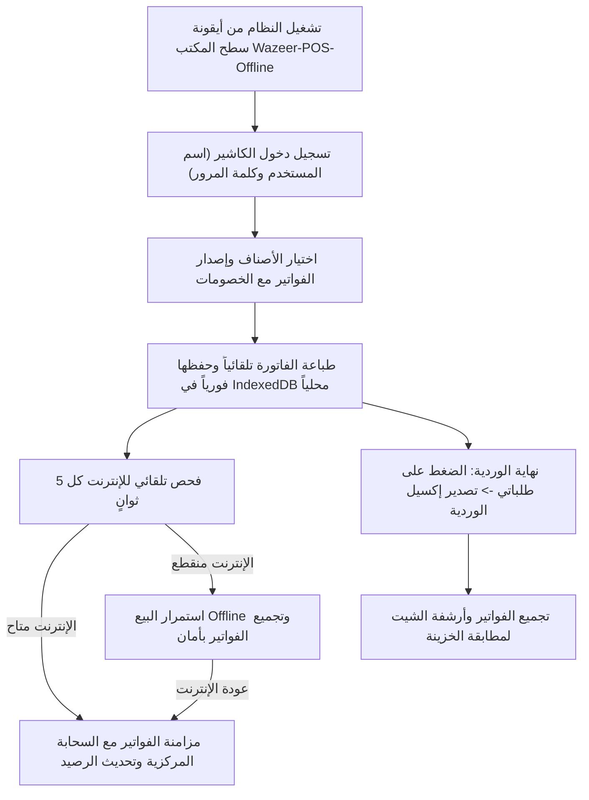

# 🍬 دليل المستخدم والتهيئة لأول مرة — نظام نقاط البيع دون اتصال (POS Offline)
### سلسلة حلويات وزير الحلو — Wazeer El-Helw Confectionery
---

## 📌 نظرة عامة
تم تصميم نظام نقاط البيع **(Wazeer El-Helw POS Offline-First)** ليعمل بكفاءة وسرعة فائقة داخل فروع ومحطات البيع حتى في حال **انقطاع الإنترنت تماماً أو بطء الشبكة**. يقوم النظام بحفظ جميع الفواتير والمعاملات محلياً في قاعدة بيانات سريعة (IndexedDB) مع إمكانية تصدير شيتات إكسيل شاملة لكل وردية وتزامن تلقائي بمجرد عودة الاتصال.

---

## 🚀 1. التثبيت والتهيئة لأول مرة (بنقرة واحدة)

لتجهيز أي جهاز كمبيوتر جديد في الفرع ليعمل كنقطة بيع، ما عليك سوى تشغيل ملف الإعداد التلقائي:

```cmd
pos-offline\SETUP-FIRST-TIME.bat
```

### 🔍 ماذا يفعل سكريبت `SETUP-FIRST-TIME.bat` تلقائياً؟
1. **فحص بيئة تشغيل Node.js و NPM:**
   - يتحقق من وجود `node -v` على الجهاز.
   - في حال عدم وجوده، يقوم السكريبت بتنزيله وتثبيته تلقائياً بصمت عبر حزمة Windows Package Manager (`winget`) أو التنزيل المباشر لحزمة `node-v20-x64.msi`.
2. **فحص متصفح الكاشير المتوافق (Google Chrome أو Microsoft Edge):**
   - يتأكد من مسار المتصفح لدعم وضع ملء الشاشة والطباعة الفورية المباشرة بدون نوافذ حوارية (`--kiosk --kiosk-printing`).
3. **فحص مكتبات وملفات تشغيل النظام:**
   - يتأكد من جاهزية ملفات نقطة البيع (`preview.html`, `real-products.json`, `wazeer-brand-pos.ico`).
   - يتأكد من تثبيت حزم الاعتماديات الأساسية.
4. **إنشاء مجلد فواتير إكسيل مخصص لكل كاشير:**
   - ينشئ مجلداً على سطح المكتب باسم:
     `Desktop\فواتير ورديات الكاشير - وزير الحلو`
   - يضع بداخله مجلد أرشيف وملف تعليمات لحماية الفواتير.
5. **إنشاء وتثبيت أيقونات سطح المكتب الرسمية:**
   - **`Wazeer-POS-Offline.lnk`**: اختصار تشغيل نقطة البيع بشعار وزير الحلو الرسمي.
   - **`Wazeer-Cashier-Excel-Reports.lnk`**: اختصار فوري لفتح مجلد شيتات الإكسيل.
6. **تحديث ذاكرة أيقونات ويندوز (Icon Cache Flush):**
   - لظهور الأيقونات بشكل فوري وأنيق على سطح مكتب الكاشير.

---

## 📊 2. حفظ وأرشفة شيتات إكسيل الوردية (Excel Export)

لحماية بيانات الفروع ومطابقة الخزينة بأعلى درجات الأمان:
1. يتم حفظ كل وردية في ملف إكسيل مخصص باسم:
   $$\text{وردية\_[اسم\_الكاشير]\_[التاريخ].xlsx}$$
   *مثال:* `وردية_احمد_سالم_2026-11-20.xlsx`
2. **أعمدة الشيت الصادر:**
   - **م**: مسلسل الفاتورة.
   - **اسم الكاشير**: اسم الكاشير المسؤول عن إصدار الفاتورة.
   - **رقم الفاتورة**: الرمز التعريفي للفاتورة.
   - **الوقت**: توقيت العملية بالساعة والدقيقة والثانية.
   - **الأصناف المباعة والبيان**: قائمة الحلويات المباعة بالتفصيل.
   - **الكمية**: عدد القطع المباعة.
   - **المبلغ (ج.م)**: القيمة الإجمالية بعد تطبيق أي خصومات.
   - **طريقة الدفع**: نقداً (كاش 💵) أو فيزا / بطاقة (💳).
   - **حالة السداد والمزامنة**: مسدد ومحفوظ محلياً / متزامن سحابياً.
   - **صف ختامي ملخص للوردية**: إجمالي مبيعات الوردية، إجمالي الكاش، إجمالي الفيزا، وإجمالي عدد القطع.

### 📥 أداة تجميع الفواتير التلقائية:
عند قيام الكاشير بتصدير الملف، يقوم المتصفح بتنزيله في مجلد التنزيلات (Downloads). يمكنك بنقرة واحدة تشغيل:
```cmd
pos-offline\ORGANIZE-EXCEL-EXPORTS.bat
```
أو من داخل مجلد سطح المكتب:
```cmd
تجميع_الفواتير_الجديدة_من_التنزيلات.bat
```
حيث يقوم بنقل كافة ملفات `وردية_*.xlsx` فوراً إلى مجلد الأرشيف المنظم.

---

## 🔑 3. بيانات الدخول الافتراضية للفروع

يعمل تسجيل الدخول بنفس بيانات الأونلاين المعتمدة:

| الحقل | القيمة الافتراضية 1 | القيمة الافتراضية 2 |
| :--- | :--- | :--- |
| **اسم المستخدم / الكود** | `cashier_korba` | `101` |
| **كلمة المرور** | `Korba@2026` | `123456` |
| **المشرف العام** | `admin` | `999` (كلمة المرور: `Admin@2026`) |

---

## ⚡ 4. التشغيل اليومي ودورة العمل



---

## 🛠️ 5. حل المشكلات الشائعة (Troubleshooting)

### س 1: هل يتطلب النظام إنترنت للعمل يومياً؟
**لا.** النظام مصمم بتقنية **Offline-First**. يمكن للفرع العمل طوال اليوم بدون اتصال بالإنترنت، وحفظ كافة الفواتير، وطباعة الإيصالات، وتصدير شيتات الإكسيل. بمجرد توفر الإنترنت، تتم المزامنة تلقائياً دون أي تدخل بشري.

### س 2: ماذا لو لم يظهر اختصار سطح المكتب؟
قم بتشغيل ملف `pos-offline\CREATE-DESKTOP-ICON.bat` أو إعادة تشغيل `pos-offline\SETUP-FIRST-TIME.bat` لإعادة بناء الاختصارات وتحديث ذاكرة الأيقونات فوراً.

### س 3: كيف تعمل الطباعة الصامتة التلقائية (Silent Printing)؟
يقوم ملف التشغيل `START-POS-OFFLINE.bat` بتمرير أعلام متصفح احترافية:
- `--kiosk`: تشغيل النظام بملء الشاشة المخصصة لنقاط البيع.
- `--kiosk-printing`: إرسال أمر الطباعة لطابعة الإيصالات الحرارية مباشرة دون إظهار نافذة تأكيد الطباعة في ويندوز لتسريع خدمة العملاء.
- `--user-data-dir="C:\Hafez_POS_Profile"`: عزل بيانات الكاشير في ملف تعريف مستقل لمنع مسح الكوكيز أو قاعدة البيانات المحلية عن طريق الخطأ.

---

### 📞 الدعم الفني
* **سلسلة حلويات وزير الحلو** — إدارة تقنية المعلومات والتحول الرقمي.
* تم إعداد هذا الدليل لتوفير أعلى درجات الاعتمادية والاستقرار لجميع فروع ومحطات البيع.
